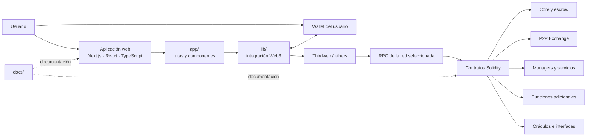

# CambiaCripto · P2P Web3

<p align="center">
  
</p>

[](https://nextjs.org/)
[](https://react.dev/)
[](https://www.typescriptlang.org/)
[](https://soliditylang.org/)
[](https://hardhat.org/)
[](https://pnpm.io/)
[](LICENSE.txt)

**CambiaCripto** es un proyecto de código abierto que explora una experiencia de intercambio P2P de criptoactivos y monedas fiat. Este repositorio reúne una aplicación web basada en Next.js y una colección de contratos Solidity gestionados con Hardhat.

> **Estado:** proyecto en desarrollo. La existencia de una pantalla, un contrato o un script no implica que la función esté completa, auditada o lista para producción. No uses fondos reales ni despliegues en mainnet sin revisión independiente.

**Mantenedor:** `deoc31416` · **Licencia:** [MIT](LICENSE.txt) · **Contribuciones:** [CONTRIBUTING.md](CONTRIBUTING.md)

## Contenido

- [CambiaCripto · P2P Web3](#cambiacripto--p2p-web3)
  - [Contenido](#contenido)
  - [Qué incluye](#qué-incluye)
  - [Arquitectura](#arquitectura)
  - [Estructura del repositorio](#estructura-del-repositorio)
  - [Requisitos](#requisitos)
  - [Inicio rápido](#inicio-rápido)
  - [Aplicación web](#aplicación-web)
  - [Contratos inteligentes](#contratos-inteligentes)
  - [Configuración](#configuración)
  - [Documentación](#documentación)
  - [Seguridad](#seguridad)
  - [Contribuir](#contribuir)
  - [Licencia](#licencia)

## Qué incluye

- Interfaz web construida con Next.js App Router, React y TypeScript.
- Código de integración Web3 en `lib/` y componentes de conexión de wallet en `app/`.
- Contratos Solidity agrupados por dominio en [`contratos/contracts/`](contratos/contracts/).
- Configuración de Hardhat, scripts de despliegue, verificación y pruebas bajo `contratos/`.
- Documentación de arquitectura y notas de desarrollo bajo `docs/`.

Las capacidades de la interfaz y los contratos pueden encontrarse en distintos niveles de implementación. Consulta el código y la documentación correspondiente antes de depender de una funcionalidad.

## Arquitectura



El diagrama representa las capas y carpetas del repositorio, no garantiza que cada integración o flujo esté habilitado en el despliegue actual.

## Estructura del repositorio

```text
.
├── app/                  # Aplicación Next.js, rutas y componentes
├── lib/                  # Lógica compartida e integración Web3
├── contratos/
│   ├── contracts/        # Contratos Solidity e interfaces
│   ├── scripts/          # Despliegue y verificación
│   ├── test/             # Pruebas de contratos (si están presentes)
│   └── hardhat.config.js # Configuración Hardhat
├── docs/                 # Arquitectura, análisis y notas del proyecto
├── public/               # Recursos estáticos
├── .env.example          # Plantilla de entorno de la aplicación
├── package.json          # Scripts y dependencias web
└── pnpm-lock.yaml        # Lockfile de pnpm
```

## Requisitos

- Node.js compatible con Next.js 15 (se recomienda una versión LTS vigente).
- pnpm 9.15 o una versión compatible.
- Para compilar o probar contratos: Node.js 18 o posterior y npm 9 o posterior, según `contratos/package.json`.

## Inicio rápido

Clona el repositorio usando la URL que se publique en GitHub y entra en su directorio:

```bash
git clone <URL-del-repositorio>
cd <directorio-del-repositorio>
pnpm install
```

Si vas a usar variables locales, crea `.env.local` a partir de la plantilla. En PowerShell:

```powershell
Copy-Item .env.example .env.local
```

En macOS o Linux:

```bash
cp .env.example .env.local
```

Edita solo los valores necesarios y ejecuta el servidor de desarrollo:

```bash
pnpm dev
```

Abre `http://localhost:3000` en el navegador.

## Aplicación web

Scripts definidos en el `package.json` raíz:

| Comando | Descripción |
| --- | --- |
| `pnpm dev` | Inicia Next.js en modo desarrollo. |
| `pnpm build` | Genera la compilación de producción. |
| `pnpm start` | Sirve la compilación generada. |
| `pnpm lint` | Ejecuta el linter configurado. |
| `pnpm dev:clean` | Limpia `.next` e inicia el servidor de desarrollo. |

## Contratos inteligentes

Los contratos Solidity, la configuración y los comandos de Hardhat se describen en el [README de contratos](contratos/README.md). Para empezar por separado:

```bash
cd contratos
npm install
npm run compile
npm test
```

Configura credenciales locales solo cuando sean necesarias. No uses claves con fondos reales para pruebas. Los despliegues a testnet y mainnet son operaciones explícitas y deben revisarse cuidadosamente.

## Configuración

- La plantilla de la aplicación está en [`.env.example`](.env.example).
- La plantilla de contratos está en [`contratos/.env.example`](contratos/.env.example).
- Los archivos `.env.local`, `.env` y sus variantes con credenciales deben permanecer locales e ignorados por Git.
- Toda variable con prefijo `NEXT_PUBLIC_` queda expuesta al navegador. No pongas secretos ni claves privadas en ellas.

## Documentación

- [Índice y mapa documental](docs/README.md)
- [Estado verificado y trabajo pendiente](docs/project/STATUS.md)
- [Matriz de rutas](docs/project/ROUTES.md)
- [Inventario de contratos](docs/contracts/CATALOG.md)
- [Arquitectura actual](docs/project/ARCHITECTURE.md)
- [Política y guía de seguridad](docs/security/POLICY.md)
- [Documentación de contratos](contratos/README.md)

Los análisis y planes históricos bajo `docs/` pueden estar desactualizados. Consulta el índice antes de usarlos.

## Seguridad

Este repositorio no constituye una auditoría de seguridad ni una garantía de disponibilidad, custodia o resultados financieros. Antes de cualquier despliegue real:

1. Revisa los contratos y sus permisos, dependencias, configuración y parámetros de red.
2. Ejecuta y amplía las pruebas en un entorno local y en testnet.
3. Solicita una auditoría independiente de los contratos y de la aplicación.
4. Verifica que las claves de despliegue se gestionen fuera del repositorio y con privilegios mínimos.

Para reportar una vulnerabilidad, contacta al mantenedor de forma privada antes de publicar detalles explotables en un issue público.

## Contribuir

Lee la [guía de contribución](CONTRIBUTING.md). Para cambios en contratos, explica el alcance, los riesgos y las pruebas realizadas. No incluyas secretos, datos personales ni artefactos de despliegue.

## Licencia

Este proyecto se distribuye bajo la licencia [MIT](LICENSE.txt).


