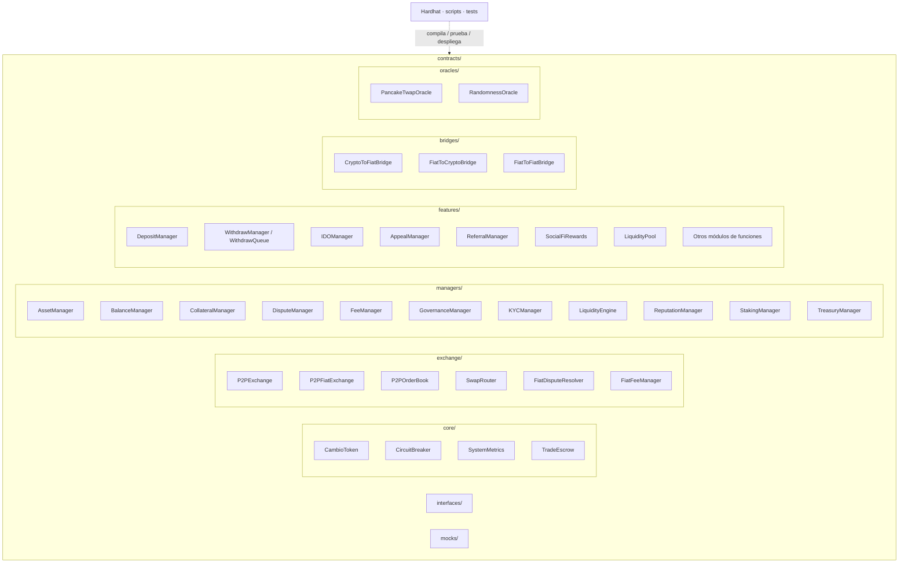
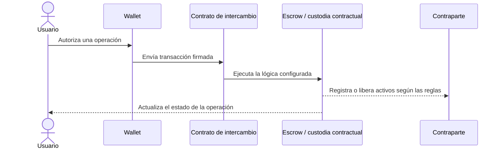

# Contratos inteligentes · CambiaCripto

[](https://soliditylang.org/)
[](https://hardhat.org/)
[](https://docs.openzeppelin.com/contracts/5.x/)
[](https://hardhat.org/hardhat-runner/docs/guides/test-contracts)
[](../LICENSE.txt)

Este directorio contiene los contratos Solidity y la configuración de Hardhat del proyecto CambiaCripto. Los contratos están organizados por dominios (core, exchange, managers, features, bridges y oracles), además de interfaces y mocks.

> **Aviso:** el código está en desarrollo. No se afirma que los contratos estén auditados ni listos para producción. No despliegues en mainnet ni uses fondos reales sin pruebas exhaustivas y una auditoría independiente.

**Proyecto:** [README principal](../README.md) · **Mantenedor:** `deoc31416` · **Licencia:** [MIT](../LICENSE.txt)

## Contenido

- [Arquitectura de contratos](#arquitectura-de-contratos)
- [Módulos](#módulos)
- [Estructura](#estructura)
- [Requisitos](#requisitos)
- [Instalación y comandos](#instalación-y-comandos)
- [Variables de entorno](#variables-de-entorno)
- [Despliegue](#despliegue)
- [Seguridad](#seguridad)

## Arquitectura de contratos

El siguiente mapa muestra la organización por carpeta del código que existe en `contracts/`. No representa por sí mismo un grafo de llamadas ni dependencias de despliegue entre contratos.



### Flujo conceptual de una operación P2P



Este es un esquema ilustrativo del patrón esperado; el flujo real depende del contrato, sus permisos y la implementación desplegada. No debe interpretarse como garantía de custodia o resolución automática.

## Módulos

| Carpeta | Ejemplos de contratos | Propósito según su organización |
| --- | --- | --- |
| `core/` | `CambioToken`, `TradeEscrow`, `CircuitBreaker`, `SystemMetrics` | Contratos base y mecanismos transversales. |
| `exchange/` | `P2PExchange`, `P2PFiatExchange`, `P2POrderBook`, `SwapRouter` | Intercambio, órdenes y rutas de swap. |
| `managers/` | `AssetManager`, `BalanceManager`, `FeeManager`, `KYCManager`, `StakingManager`, `TreasuryManager` | Gestión de activos, saldos, tarifas, permisos y servicios. |
| `features/` | `DepositManager`, `WithdrawManager`, `IDOManager`, `AppealManager`, `ReferralManager`, `SocialFiRewards` | Módulos funcionales adicionales. |
| `bridges/` | `CryptoToFiatBridge`, `FiatToCryptoBridge`, `FiatToFiatBridge` | Flujos puente relacionados con activos cripto y fiat. |
| `oracles/` | `PancakeTwapOracle` | Adaptadores de consulta de precio/oráculo. |
| `interfaces/` | `IAssetManager`, `IFeeManager`, `IPriceOracle` y otras | Interfaces compartidas por módulos. |
| `mocks/` | `MockERC20`, `MockWBNB` | Contratos de apoyo para desarrollo y pruebas. |

Consulta los archivos Solidity para conocer la implementación, roles, dependencias y límites efectivos de cada contrato.

## Estructura

```text
contratos/
├── contracts/
│   ├── bridges/
│   ├── core/
│   ├── exchange/
│   ├── features/
│   ├── interfaces/
│   ├── managers/
│   ├── mocks/
│   └── oracles/
├── scripts/             # Scripts de despliegue y verificación
├── test/                # Carpeta de pruebas (aún no presente en esta copia)
├── .env.example         # Plantilla; completar solo en entorno local
├── hardhat.config.js
└── package.json
```

## Requisitos

- Node.js 18 o posterior.
- npm 9 o posterior.
- Acceso a un RPC solo para interacción con redes; compilación y pruebas locales pueden ejecutarse sin desplegar.

## Instalación y comandos

Desde la raíz del repositorio:

```bash
cd contratos
npm install
```

Comandos definidos en `package.json`:

| Comando | Descripción |
| --- | --- |
| `npm run compile` | Compila los contratos con Hardhat. |
| `npm test` | Ejecuta las pruebas Hardhat; no se encontró una carpeta `test/` en esta copia. |
| `npm run test:coverage` | Ejecuta la cobertura configurada. |
| `npm run test:gas` | Ejecuta pruebas con informe de gas. |
| `npm run lint` | Ejecuta Solhint sobre `contracts/**/*.sol`. |
| `npm run format` | Aplica Prettier a los archivos Solidity. |
| `npm run node` | Inicia un nodo Hardhat local. |
| `npm run size` | Genera el informe de tamaño de contratos. |

## Variables de entorno

La plantilla está en [`.env.example`](.env.example). Para trabajar localmente, crea `.env` a partir de ella y completa solo lo necesario. En PowerShell:

```powershell
Copy-Item .env.example .env
```

En macOS/Linux:

```bash
cp .env.example .env
```

Las claves privadas de deployer, operator y admin, junto con credenciales de exploradores, deben existir únicamente en el entorno local o en un gestor de secretos. No pegues claves reales en el README, los scripts, los issues ni Git. Usa wallets desechables sin fondos reales para testnet.

## Despliegue

El `package.json` define comandos de despliegue separados por módulo y red, además de `deploy:all:testnet` y `deploy:all:mainnet`. Antes de ejecutar cualquiera:

1. Inspecciona el script que vas a ejecutar y confirma la red seleccionada.
2. Verifica las direcciones, roles, parámetros y cuentas que recibirá cada contrato.
3. Ejecuta primero en una red local y después en testnet.
4. No uses comandos `*:mainnet` hasta completar revisión y auditoría independiente.

Ejemplo de compilación y pruebas locales:

```bash
npm run compile
npm test
```

Aunque el script `npm test` está definido, no se encontró una carpeta `test/` en esta copia; agrega pruebas antes de tratar el proyecto como verificado. Los nombres de scripts tampoco garantizan que los módulos estén completos ni que los despliegues hayan sido verificados.

## Seguridad

- No compartas claves privadas, frases semilla, archivos `.env` ni keystores.
- Revisa las dependencias y los contratos heredados antes de desplegar.
- Comprueba límites de permisos, pausas, retiros, reentrancia, oráculos, actualizaciones y supuestos de confianza.
- Reporta vulnerabilidades de forma privada al mantenedor antes de publicar detalles explotables.

Consulta el [inventario completo de contratos](../docs/contracts/CATALOG.md), el [README principal](../README.md), el [estado del proyecto](../docs/project/STATUS.md), la [guía de seguridad](../docs/security/POLICY.md) y el [índice documental](../docs/README.md).


