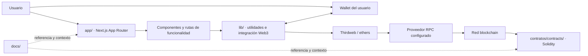

# Arquitectura actual

Este documento describe la organización observable de la copia del repositorio a 14 de noviembre de 2026. Es un mapa de código, no una validación de que las integraciones funcionen de extremo a extremo.

## Capas del repositorio

El dibujo no afirma una relación contractual específica, una red activa ni un backend operativo. Verifica cada flujo contra el código de la funcionalidad correspondiente.

## Aplicación web

La aplicación usa Next.js App Router. Las rutas de funcionalidades se agrupan bajo `app/(features)/`; la lógica compartida y utilidades Web3 están bajo `lib/`. La lista de rutas visible en el árbol se resume en [Estado del proyecto](STATUS.md). Que una ruta exista no acredita que todos sus datos sean reales ni que firme una transacción.

## Contratos

Las fuentes están en `contratos/contracts/`, con directorios `core`, `exchange`, `features`, `bridges`, `interfaces`, `managers`, `mocks` y `oracles`. La configuración de Hardhat declara redes locales y BSC testnet/mainnet. No se verificaron despliegues en ninguna red.

Para categorías y comandos, consulta el [README de contratos](../../contratos/README.md). Los diagramas de carpetas no deben interpretarse como un grafo de llamadas; para declarar dependencias entre contratos, comprueba imports, constructores y llamadas en Solidity.

## Integraciones externas

La presencia de SDKs o configuración no es prueba de que exista un servicio activo. Antes de documentar integraciones de wallet, RPC, precios, fiat, KYC, analytics u oráculos, identifica en el código el punto de entrada, los datos transmitidos, las claves requeridas y el comportamiento ante fallo.

## Convenciones para cambios

Cuando se añada o cambie una capa, actualiza el diagrama, las variables de entorno relevantes, los límites de confianza, los errores esperados y las pruebas. Distingue claramente estado local, testnet y mainnet.

